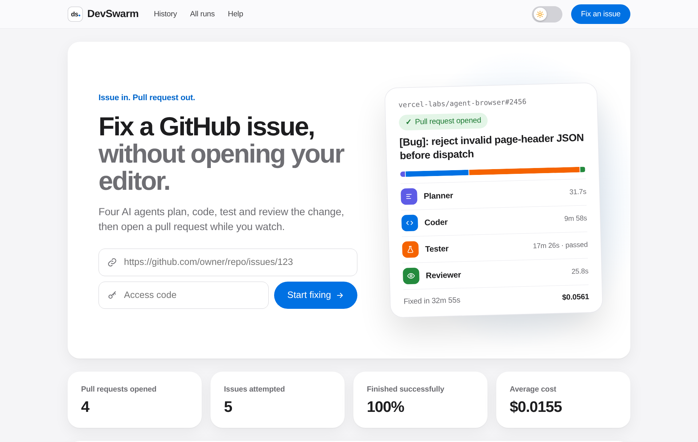
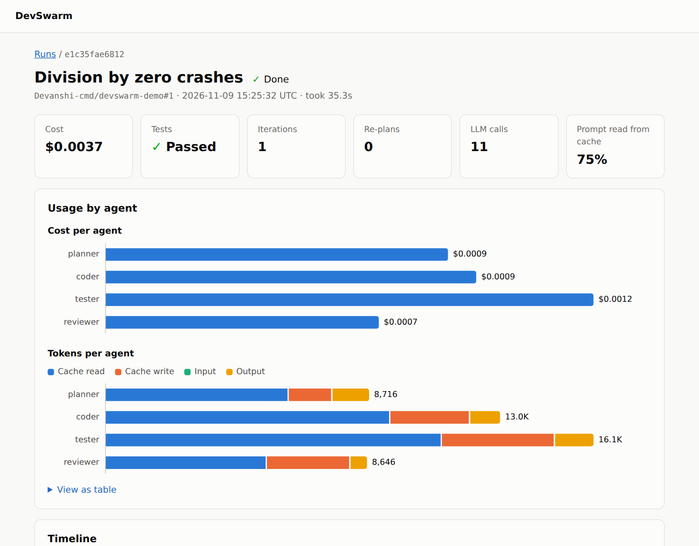
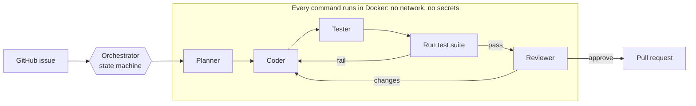

# DevSwarm

**Give it a GitHub issue, and it opens a tested pull request.** A Planner, Coder, Tester and Reviewer work together, with every command running in a locked-down Docker container and no human involved until review.

**See a real result:** [this pull request](https://github.com/Devanshi-cmd/devswarm-demo/pull/2) was produced from [this issue](https://github.com/Devanshi-cmd/devswarm-demo/issues/1), end to end, for $0.0037.

**Try the live dashboard:** [devswarm.devanshitiwari.com](https://devswarm.devanshitiwari.com) shows every fix, and lets anyone with the access code submit an issue and watch the agents work.



## Highlights

- **Hand-written agent loop.** Built directly on the Claude Messages API, with no agent framework.
- **Deterministic orchestrator.** A pure state machine routes the work, enforces budgets, and detects loops. The model never decides what happens next.
- **Models can't grade themselves.** DevSwarm runs the tests itself and goes by the exit code. The Tester can only change test files.
- **Built for untrusted code.** No network or secrets in the sandbox, read-only `.git`, symlink-safe file tools, and prompt-injection defences.
- **Measured.** 18 tasks scored by hidden tests the agents never see, compared against headless Claude Code.
- **Observable.** Every prompt, tool call and cent is recorded and shown in the dashboard.

## Dashboard

Every run gets its own page. It shows how long each agent took, what each one cost, how much of the prompt came from cache, and whether the tests passed, followed by a step-by-step timeline and the final diff. The dashboard has a day and a night theme, and a "How it works?" page that animates one fix from issue to pull request.



## How it works



Agents only receive summaries of each other's work, which keeps prompts small and reviews independent. Each run has limits on cost, tokens, time and iterations. If the same change or the same failure keeps repeating, DevSwarm resets the code and re-plans once, then stops with a report of what it tried.

[Read the full walkthrough](docs/HOW_IT_WORKS.md).

## Results

All 18 tasks were run once per configuration. A task counts as solved only if the system finished and the hidden tests pass.

| Configuration | Solved | Avg cost per task | Avg time per task |
|---|---|---|---|
| DevSwarm on Haiku, with Reviewer | 18/18 | $0.0071 | 63s |
| DevSwarm on Haiku, no Reviewer | 18/18 | $0.0048 | 39s |
| Claude Code on Sonnet, alone | 18/18 | $0.0418 (notional) | 10s |

- **Every configuration solved everything,** so this suite does not show that any of them is more capable. These are small, self-contained tasks.
- **DevSwarm cost about 6× less** than the figure Claude Code reports for Sonnet, because it uses a far cheaper model. Claude Code ran on a subscription login, so its figure wasn't actually billed.
- **Claude Code was about 6× faster.** DevSwarm runs four agents and builds a container.
- **The Reviewer didn't change any outcome here,** and added about 50% to the cost.

Full tables: [12 standard tasks](evals/RESULTS.md) and [6 harder tasks](evals/RESULTS_HARD.md).

## Quick start

You need Python 3.12, [uv](https://docs.astral.sh/uv/), Docker, and an Anthropic API key. The repositories DevSwarm fixes can be Python, JavaScript/TypeScript or Rust.

```bash
git clone https://github.com/Devanshi-cmd/devswarm.git
cd devswarm
uv sync
echo "ANTHROPIC_API_KEY=your-key" > .env

uv run devswarm sandbox-check --repo .
uv run devswarm run --repo examples/buggy_calc --task "division by zero crashes"
uv run devswarm dashboard
```

To fix a GitHub issue, log in with `gh auth login` or set `GITHUB_TOKEN` in `.env`:

```bash
uv run devswarm run --issue owner/repo#123 --dry-run   # everything except push and PR
uv run devswarm run --issue owner/repo#123
```

| Command | What it does |
|---|---|
| `devswarm run` | Fix a local task or a GitHub issue |
| `devswarm eval` | Score configurations against the eval tasks |
| `devswarm dashboard` | Open the web UI: submit issues, watch runs, browse history, see how it works |
| `devswarm worker` | Run the jobs submitted through the web UI |
| `devswarm report <run_id>` | Print a Markdown summary of a run |
| `devswarm runs` | List recorded runs |
| `devswarm sandbox-check` | Verify each isolation guarantee on a live container |

Each agent's model and effort can be set separately, such as `--effort coder=high`.

## Safety

| Risk | Protection |
|---|---|
| Malicious code in a repository | Every command runs in a container with no network, no secrets, no root, and resource limits. File tools on the host are confined to the working copy |
| Prompt injection in an issue | Untrusted text is kept in labelled data blocks, and a compromised agent still has nowhere to send anything |
| A planted git hook | `.git` is read-only inside the sandbox |
| Path traversal and symlink tricks | Files are opened one path component at a time, refusing symlinks |
| Damaging a branch | Only `devswarm/*` branches can be pushed, never with force |
| Leaked secrets | Redacted from logs, traces, commits and PR bodies. The token never touches `.git/config` |
| Runaway cost | Cost, token, time and iteration limits, checked before every call |
| Abuse of the public form | Submitting needs an access code, with queue and daily limits. The website holds no API key or GitHub token; only the worker does |

## Known limitations

- **Three languages.** Python, JavaScript/TypeScript and Rust. Each is one profile class, so more can be added. The hidden-test evals are still Python only.
- **Install scripts are skipped for Node,** for safety, so packages that need them may fail. Rust needs a long first build, and the Tester can only add tests under `tests/`.
- **The eval can't separate these systems yet.** It has 18 small tasks run once each, and every configuration scored 100%. Real repositories are larger and messier.
- **Forks don't reach upstream automatically.** Without write access, DevSwarm opens the pull request inside a fork and gives you a link to propose it to the original project yourself.
- **Hosted jobs run one at a time,** only on public repositories, and can't be cancelled once started.
- **Re-running an issue** fails if `devswarm/issue-N` has diverged, because replacing it would need a force-push. Delete the branch first.
- **Re-planning has only run in tests.** Retries after failing tests have happened in live runs, but none has needed a re-plan yet.
- **Prompt injection is reduced, not solved.** The sandbox limits the damage if an agent is fooled.
- **Dependency installs have network access.** Named packages can run install scripts during the image build, where no secrets or repository files are present.
- **Tests needing network or services will fail,** since the sandbox has no network.
- **The Claude Code baseline runs on the host** because it needs its login. Its transcript is checked for signs of looking at the hidden tests, but nothing physically prevents it.

## Project layout

```text
devswarm/
  agents/        Planner, Coder, Tester, Reviewer and the tool loop
  orchestrator/  State machine, budgets, loop detection, test verification
  tools/         File, search, shell and diff tools, and path safety
  sandbox/       Docker lifecycle and image building
  llm/           API client, retries, cost accounting, mock client
  github/        Git operations, issues and pull requests
  storage/       SQLite traces and secret redaction
  dashboard/     FastAPI and HTMX web UI
  evaluation/    Eval harness and scoring
evals/           Tasks and results
docs/            Walkthrough, design decisions, demo script
```

## Development

```bash
uv run pytest && uv run ruff check && uv run mypy devswarm
```

The test suite runs offline and free, using a scripted LLM client. Tests that need Docker skip themselves when it isn't available. The reasoning behind each design decision is in [docs/LEARNING.md](docs/LEARNING.md).
