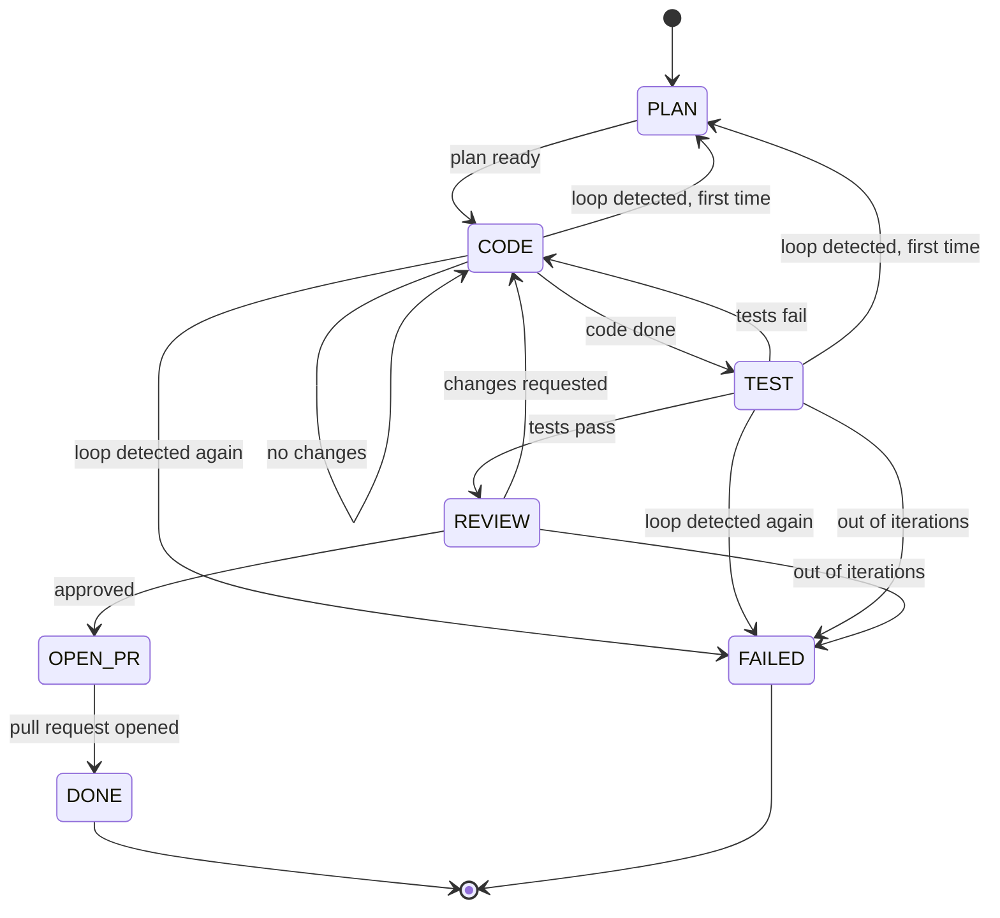
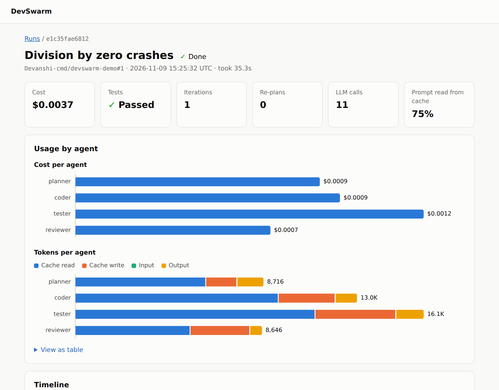

# How DevSwarm works

This follows one run from start to finish. For why each decision was made, see [LEARNING.md](LEARNING.md).

## 1. A private copy of the code

`devswarm run` never touches your checkout. For a GitHub issue it clones the repository. For a local path it clones or copies it to `.devswarm/workspaces/<run_id>/repo`, on a new branch.

## 2. A locked-down container

Each run gets one Docker container with the repository mounted at `/workspace`:

| Restriction | What it stops |
|---|---|
| `--network none` | Exfiltration, and installing anything unexpected |
| No environment secrets | Reading API keys or tokens |
| Non-root, all capabilities dropped, `no-new-privileges` | Privilege escalation |
| Read-only root filesystem | Tampering with the image |
| `.git` mounted read-only | Planting a hook that later runs on the host |
| CPU, memory and process limits | Runaway commands |

Dependencies are installed once, in a separate image build. That is the only step with network access.

## 3. The state machine

The orchestrator is ordinary code, not an LLM. `transition(state, event, counters, config)` is a pure function, so every path can be tested exactly.

Any state can also move to `FAILED` when a budget runs out or an agent can't continue. A failed run writes a report explaining what was tried.

## 4. The agents

All four share one hand-written loop in `devswarm/agents/base.py`. It sends messages, runs the tools the model asks for, returns the results, and repeats until the model calls `finish`.

| Agent | Tools | Produces |
|---|---|---|
| Planner | Read, list, search | Steps, files to touch, acceptance criteria, risks |
| Coder | Read, list, search, edit, create, run, diff | A summary and the changed files |
| Tester | Same as the Coder, limited to test files | What was tested and any bugs found |
| Reviewer | Read, list, search, diff | Approve or request changes, with specific feedback |

Agents never see each other's transcripts. The orchestrator passes each one a summary: the plan, the current diff, failing test output, and reviewer feedback. This keeps context small and stops the Reviewer from being swayed by the Coder's reasoning.

## 5. Code never gets to grade itself

- **DevSwarm runs the test suite itself.** The exit code decides whether tests passed, never an agent's claim.
- **The Tester can only change tests.** Before and after it runs, the whole working tree is recorded as a git tree. Any change outside test files is undone, including changes made through a shell command.
- **Coder edits to tests are flagged.** They are allowed, because intended behaviour can change, but the Reviewer is told exactly which tests were touched.

## 6. Staying out of loops

| Signal | Response |
|---|---|
| The same source diff appears twice | Loop detected |
| The same test fails with the same error 3 times | Loop detected |
| First loop | Reset the code and re-plan, telling the Planner what failed |
| Second loop | Stop and write a failure report |

Failures are compared by test name and error type, because full messages contain details such as memory addresses that change between runs.

## 7. Budgets and cost

Every run has limits on cost (default $1.00), tokens, wall-clock time and iterations. They are checked before every LLM call, so a run can overshoot by at most one call.

Prompt caching does most of the cost work. Conversations are strictly append-only, which keeps the cached prefix valid and is required by the API when thinking blocks are replayed. Agents also stop well before the 100K-token point where Haiku's price rises 5×.

## 8. Publishing the result

`push_branch` is the only code that can write to a remote. It only pushes `devswarm/*` branches, refuses the default branch, and never force-pushes. The GitHub token reaches git only through the environment of a single command, so it is never saved in `.git/config`, where an agent could read it. Titles, PR bodies and commit messages are all scrubbed for secrets.

## 9. Observability

Every LLM call and tool call goes to SQLite, with secrets removed on the way in. Because conversations are append-only, each row stores only the new messages. The dashboard reads this database through a read-only connection, and treats everything in it as untrusted.

Each run's page shows how long each stage took, the cost per agent, how much of the prompt came from cache, the test result, every step with its prompts and tool calls, and the final diff. The dashboard's "How it works?" page tells this walkthrough in pictures, as an animated fix in ten steps.

## 10. Evaluation

`devswarm eval` runs buggy tasks and scores them with hidden tests. Agents only ever receive a task's `repo/` folder. The hidden tests join the code in a fresh container after the agents have stopped, and scoring ignores any pytest configuration in the repository. A test proves that every task's bug is real and that a reference fix passes.
